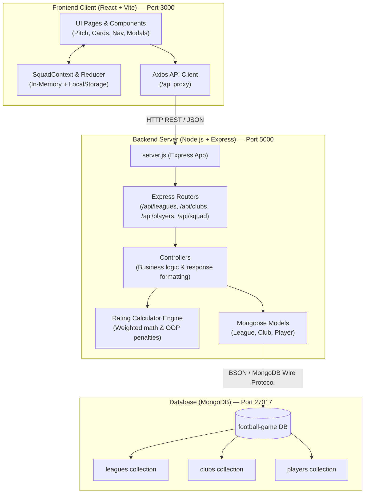
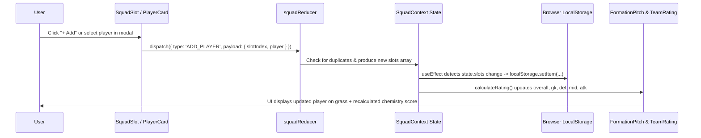

# ⚽ Football Game — Master Technical Specification & Architecture Plan

This document serves as the comprehensive architectural guide, technical design blueprint, and step-by-step operational manual for the **Football Game** full-stack MERN application.

---

## 1. High-Level Architecture Overview

Football Game is designed using a decoupled **client-server architecture**:
- **Frontend Layer**: Client-side single-page application (SPA) built with React and Vite. Handles user interaction, tactical pitch visualization, client-side state, and instantaneous chemistry calculations.
- **Backend API Layer**: Node.js and Express RESTful service. Responsible for data integrity, querying MongoDB, and authoritative server-side team rating recalculation.
- **Database Layer**: MongoDB document database modeled via Mongoose schemas with relational referencing, indexing, and strict schema validation.



---

## 2. Technology Stack & Language Breakdown

### 2.1 Languages
| Technology | Role | Details |
| :--- | :--- | :--- |
| **JavaScript (ES6+)** | Universal Language | Used across both frontend (ES Modules: `import`/`export`) and backend (CommonJS: `require`/`module.exports`). |
| **HTML5** | Semantic Document Markup | Accessible semantic structure with Google Fonts integration (*Outfit* & *Inter*). |
| **CSS3 (Modern Vanilla)** | Design System & Styling | CSS Custom Properties (design tokens), Flexbox, CSS Grid, Glassmorphism backdrop-filters, custom cubic-bezier transitions, and media queries. No external CSS frameworks to maximize control and performance. |

### 2.2 Backend Technologies
| Package / Tool | Purpose | How It Works |
| :--- | :--- | :--- |
| **Node.js (v18+)** | Runtime Environment | High-performance asynchronous, event-driven JavaScript engine running on Google Chrome's V8. |
| **Express (v5)** | Web Application Framework | Handles routing, incoming HTTP requests, middleware pipeline, JSON parsing (`express.json()`), and response status codes. |
| **Mongoose (v9)** | Object Data Modeling (ODM) | Enforces structured schemas over MongoDB collections, handles type casting, data validation, and reference population (`.populate()`). |
| **dotenv** | Environment Variable Management | Injects sensitive runtime configuration (e.g., `MONGO_URI`, `PORT`, `NODE_ENV`) into `process.env`. |
| **cors** | Cross-Origin Resource Sharing | Configures HTTP headers allowing safe communication between client (port 3000) and server (port 5000). |
| **Docker** | Containerization | Runs MongoDB in an isolated Linux container (`football-mongo` on port 27017) ensuring portable setup. |

### 2.3 Frontend Technologies
| Package / Tool | Purpose | How It Works |
| :--- | :--- | :--- |
| **React (v19)** | UI Library | Component-based declarative rendering using JSX, virtual DOM reconciliation, and modern hooks (`useState`, `useEffect`, `useReducer`, `useCallback`, `useContext`). |
| **Vite (v8)** | Bundler & Dev Server | Ultra-fast Hot Module Replacement (HMR) powered by native ES modules. Automatically proxies `/api` requests to `http://localhost:5000`. |
| **React Router DOM (v7)** | Client-Side Routing | Dynamic URL routing (`/`, `/leagues`, `/leagues/:leagueId`, `/clubs/:clubId`, `/players/:playerId`, `/squad`) without full browser reloads. |
| **Axios** | HTTP Client | Promise-based asynchronous HTTP client configured with base URL and centralized headers. |

---

## 3. Directory Structure & File Responsibilities

```
football-game/
├── package.json                   # Root orchestrator
├── .gitignore                     # Excludes node_modules/, .env, dist/, build logs
├── .env.example                   # Root environment template
├── README.md                      # Project documentation and quickstart
├── TECHNICAL_PLAN.md              # Detailed architecture and engineering plan (this file)
│
└── frontend/                      # Main Workspace (React + Vite + Backend)
    ├── index.html                 # HTML shell with meta tags and Google Fonts
    ├── vite.config.js             # Vite build options + proxy config (/api -> :5000)
    ├── package.json               # Combined scripts (concurrently Vite + Express)
    ├── src/
    │   ├── main.jsx               # ReactDOM root, BrowserRouter, SquadProvider
    │   ├── App.jsx                # Route definitions and persistent layout shell
    │   ├── index.css              # Global tokens, dark theme, utilities, animations
    │   ├── api/
    │   │   └── axiosClient.js     # Axios instance pointing to /api
    │   ├── context/
    │   │   └── SquadContext.jsx   # Squad state (useReducer), localStorage persistence
    │   ├── components/
    │   │   ├── Navbar.jsx / .css  # Header navigation with real-time squad counter
    │   │   ├── Footer.jsx         # Footer branding
    │   │   ├── PlayerCard.jsx / .css # FIFA-style player card with stat pills
    │   │   ├── RatingBar.jsx / .css # Animated 0-99 horizontal progress bars
    │   │   ├── FormationPitch.jsx / .css # SVG/CSS grass football pitch with field markings
    │   │   ├── SquadSlot.jsx / .css # Pitch position slot with OOP warning tag
    │   │   ├── TeamRating.jsx / .css# Breakdown card (GK/DEF/MID/ATK) & API verification
    │   │   └── PlayerSelectModal.jsx / .css # Searchable modal to pick player for a slot
    │   └── pages/
    │       ├── HomePage.jsx / .css     # Hero showcase, live DB counters, feature cards
    │       ├── LeaguesPage.jsx / .css  # Major league directory
    │       ├── ClubsPage.jsx / .css    # Clubs within a league
    │       ├── PlayersPage.jsx / .css  # Club roster with filters and stat sorting
    │       ├── PlayerDetailPage.jsx / .css # 6 attribute radar bars and tactical insights
    │       └── SquadBuilderPage.jsx / .css # 4-3-3 tactical board with Auto-Draft
    │
    └── backend/                   # Embedded Backend Service (Node.js + Express)
        ├── server.js              # Express app entry, middleware stack, listener
        ├── package.json           # Express, Mongoose, Dotenv, Cors
        ├── .env                   # Local secrets (PORT=5000, MONGO_URI)
        ├── config/db.js           # Mongoose MongoDB connection logic
        ├── middleware/            # 404 handler and global exception middleware
        ├── models/                # Mongoose schemas (League, Club, Player)
        ├── routes/                # REST routes (/api/leagues, /api/clubs, /api/players, /api/squad)
        ├── controllers/           # Business logic & response formatting
        ├── utils/                 # 4-3-3 team rating mathematical logic
        └── seed/seed.js           # DB populator (2 leagues, 6 clubs, 48 players)
```

---

## 4. Step-by-Step Data Flow: How Frontend, Backend, and Database Interact

Here is the exact lifecycle of how data flows across the stack:

### Scenario A: Scouting Roster (`GET /api/players?club=XYZ`)
1. **User Action**: User navigates to `/clubs/:clubId`.
2. **React Mounts**: `PlayersPage.jsx` triggers its `useEffect` hook.
3. **Axios Request**: `api.get('/players?club=' + clubId)` sends an HTTP GET request to `http://localhost:3000/api/players?club=XYZ`.
4. **Vite Proxy**: Vite intercepts the `/api` prefix and proxies the request to Express at `http://localhost:5000/api/players?club=XYZ`.
5. **Express Router**: `server.js` routes the request through `playerRoutes.js` into `playerController.getPlayers`.
6. **Query Filter**: `playerController` extracts `req.query.club` and creates the Mongoose query `{ club: clubId }`.
7. **Mongoose & MongoDB**: Mongoose executes `Player.find({ club: clubId }).populate('club', 'name').populate('league', 'name').sort({ overall: -1 })`.
8. **BSON to JSON**: MongoDB returns the documents; Mongoose deserializes them into JSON and sends HTTP `200 OK`:
   ```json
   { "success": true, "count": 8, "data": [ ... ] }
   ```
9. **React State Update**: `PlayersPage.jsx` receives the response, calls `setPlayers(res.data.data)`, and updates state.
10. **Re-render**: React reconciles the Virtual DOM and renders 8 `PlayerCard` components with live stats and tier badges.

---

### Scenario B: 4-3-3 Squad Rating Calculation & Verification (`POST /api/squad/rating`)
1. **User Action**: The user drafts 11 players onto the pitch and clicks **"Verify Rating via API"**.
2. **Client Preparation**: `TeamRating.jsx` maps the 11 players in `slots` into an array of `{ playerId, slotIndex }`.
3. **POST Request**: Axios sends payload to `/api/squad/rating`:
   ```json
   {
     "squad": [
       { "playerId": "6ab4074edc1b869db6e30b05", "slotIndex": 0 },
       { "playerId": "6ab4074edc1b869db6e30b06", "slotIndex": 1 },
       ...
     ]
   }
   ```
4. **Express Routing**: Handled by `squadRoutes.js` ➔ `playerController.calculateSquadRating`.
5. **Database Validation**: Controller validates array length equals 11, then queries MongoDB:
   `Player.find({ _id: { $in: playerIds } })`
   to ensure all 11 player IDs are authentic and fetches their true database attributes.
6. **Rating Engine Computation**: `calculateTeamRating(squad)` executes:
   - Compares player natural position against slot position.
   - If player is out of position (e.g. ST in CB slot), applies **-3 penalty**.
   - Computes weighted line ratings:
     $$\text{Team OVR} = (\text{GK} \times 0.10) + (\text{DEF} \times 0.30) + (\text{MID} \times 0.30) + (\text{ATK} \times 0.30)$$
7. **JSON Response**:
   ```json
   {
     "success": true,
     "data": {
       "overall": 84,
       "gk": 86,
       "def": 81,
       "mid": 85,
       "atk": 86,
       "players": [ ... ]
     }
   }
   ```
8. **UI Verification Banner**: React receives the payload and renders the green verified confirmation card.

---

## 5. React State & LocalStorage Lifecycle



- **Persistence Guarantee**: If the user refreshes the browser, `getInitialSlots()` reads `football_game_squad` from `localStorage`, immediately repopulating the 4-3-3 formation without lost progress.

---

## 6. Mathematical Chemistry & Rating Model

### 6.1 Tactical Slot Mapping (4-3-3)
| Slot Index | Tactical Position | Position Group | Line Contribution |
| :---: | :---: | :---: | :---: |
| `0` | **GK** (Goalkeeper) | `GK` | **10%** |
| `1` | **LB** (Left Back) | `DEF` | **30% (divided among 4 defenders)** |
| `2` | **CB1** (Center Back 1) | `DEF` | |
| `3` | **CB2** (Center Back 2) | `DEF` | |
| `4` | **RB** (Right Back) | `DEF` | |
| `5` | **CM1** (Center Midfield 1)| `MID` | **30% (divided among 3 midfielders)** |
| `6` | **CM2** (Center Midfield 2)| `MID` | |
| `7` | **CM3** (Center Midfield 3)| `MID` | |
| `8` | **LW** (Left Wing) | `ATK` | **30% (divided among 3 attackers)** |
| `9` | **ST** (Striker) | `ATK` | |
| `10` | **RW** (Right Wing) | `ATK` | |

### 6.2 Position Compatibility Matrix
- **`GK` Group**: `GK`
- **`DEF` Group**: `CB`, `LB`, `RB`
- **`MID` Group**: `CDM`, `CM`, `CAM`
- **`ATK` Group**: `LW`, `RW`, `ST`, `CF`

### 6.3 Position-Fit Penalty Formula
$$\text{Effective Overall} = \begin{cases} \text{Overall}, & \text{if } \text{PlayerGroup} = \text{SlotGroup} \\ \max(1, \text{Overall} - 3), & \text{if } \text{PlayerGroup} \neq \text{SlotGroup} \end{cases}$$

---

## 7. Future Expansion Roadmap (V2 & Beyond)

1. **V2 — Luck-Based Pack Opening Engine**:
   - Random League ➔ Random Club ➔ Random Player reveal animation.
   - Animated pack-opening sequence using CSS 3D transforms.
2. **V3 — Matchmaking & Match Simulation**:
   - Match player's team against random community/AI squads.
   - Text-based match commentary engine simulating 90-minute matches based on comparative line ratings (Attack vs Defense, Midfield battle).
3. **V4 — User Authentication & Squad Persistence**:
   - JWT authentication (register/login).
   - MongoDB `Squad` model storing multiple named formations per user account.
4. **V5 — Real-Time Multiplayer Gameplay**:
   - WebSocket / Socket.IO integration for live head-to-head matches and tactical substitutions.
